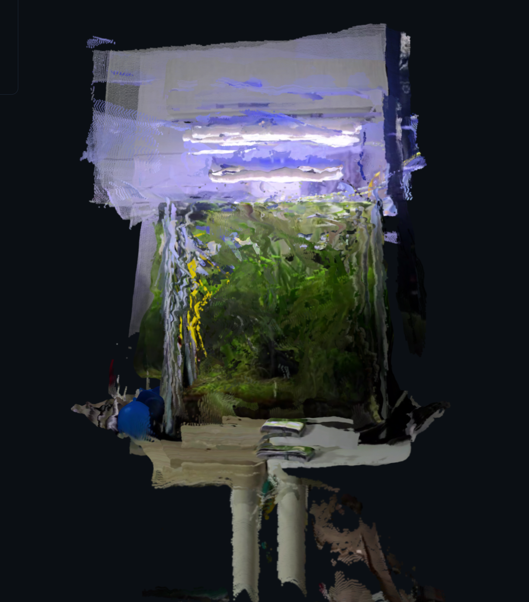

# 어항 3D 뷰어 (가우시안 스플랫)

폰으로 찍은 어항 영상 하나로 3차원 장면을 만들어 웹에 올렸습니다.

- **보기:** https://nihao72-netizen.github.io/eohang-3d/
- **장면 파일:** https://nihao72-netizen.github.io/eohang-3d/scene.sog

## 1. 공간과 공개 판단

- **고른 공간:** 집 안 수초 어항과 그 아래 받침대
- **공개해도 되는 이유:** 얼굴, 이름, 주소, 화면 속 개인정보가 찍히지 않은 어항과 받침대만 담았고, 촬영 후 영상과 3D 화면을 다시 보며 확인했습니다.

## 2. 촬영

| 항목 | 값 |
|---|---|
| 촬영한 부분 | 어항 앞면과 양옆, 위쪽 조명, 아래 받침대 |
| 걸은 경로 | 어항을 바라본 채 앞쪽에서 반원을 그리며 이동. 중간에 위에서 내려다보거나 가까이 다가간 구간이 섞임 |
| 영상 길이 | 31초 |
| 해상도 | 592 × 1280 (세로), 29.9fps, 927프레임 |
| 추출한 사진 | 24장 (긴 변 1024, 모델에는 518 × 252로 들어감) |

## 3. 복원 결과와 카메라 확인

코랩 T4에서 `facebook/map-anything-apache`(fp16)로 복원했습니다.

| 항목 | 값 |
|---|---|
| 복원 시간 | 9.2초 (최대 GPU 메모리 6.49GB) |
| 점 개수 | 2,738,585개 (거르기 전 2,821,506개, 각 축 0.5% 밖 82,921개 제외) |
| 카메라 퍼짐 비 | 1.805 ÷ 2.947 = **0.612** |
| 카메라 방향 | 24대 모두 장면 중심을 향함 (코사인 0.96 이상) |

**실제 촬영 경로와 비교:** 퍼짐 비가 기준 0.1보다 훨씬 커서 시차는 충분했습니다. 카메라 위치 그림에서도 실제로 걸은 대로 어항 **앞쪽 반원**에 카메라가 놓였고, 위에서 내려다본 구간 때문에 카메라 높이가 들쭉날쭉했습니다. 어항 **뒤쪽에는 카메라가 하나도 없습니다.**

## 4. 알갱이 변환과 형식별 크기

점 하나를 반투명 알갱이로 바꿨습니다. 반지름 = K × 장면의 가장 긴 변 ÷ √N = 1.4 × 2.3622 ÷ √2,738,585 ≈ 0.002, 불투명도 0.9, 방향별 색 계수 제외 (알갱이당 실수 17개).

변환 도구: `@playcanvas/splat-transform@3.10.3` (RTX 3050 GPU 모드)

| 형식 | 크기 (바이트) | 원본 대비 | 변환 시간 | 알갱이 | 알갱이당 바이트 |
|---|---:|---:|---:|---:|---:|
| `.ply` (원본) | 186,224,197 | 1.00배 | - | 2,738,585 | 68.000 |
| `.compressed.ply` | 44,588,278 | 4.18배 작음 | 4.06초 | 2,738,585 | 16.282 |
| **`.sog` (공개에 사용)** | **14,539,653** | **12.81배 작음** | 5.58초 | 2,738,585 | **5.309** |
| `.spz` | 17,423,622 | 10.69배 작음 | 5.61초 | 2,738,585 | 6.362 |

- 네 형식 모두 알갱이 개수가 같습니다. 크기만 달라졌고 그릴 알갱이 수는 그대로입니다.
- 원본 `.ply`는 GitHub 파일 한도(100MiB)를 넘어 올릴 수 없습니다.
- 뷰어에 끌어다 놓아 연 결과, 푸는 시간은 `.compressed.ply` 0.82초, `.sog` 0.91초, `.spz` 1.77초였습니다. 가장 작고 빠르게 열리는 `.sog`를 골랐습니다.
- 변환 시간은 다시 돌리면 1초 안팎 달라졌습니다.

## 5. 첫 화면까지 걸린 시간

| 기기 | 통신 | 첫 화면까지 | 돌릴 때 |
|---|---|---|---|
| 내 폰 (Galaxy S24) | 와이파이 | 약 3초 | 끊김 없음 |
| 다른 사람 폰 (Galaxy S24) | 와이파이 | 약 3초 | 끊김 없음 |

두 기기가 같은 기종, 같은 와이파이 환경이라 LTE나 오래된 기기에서는 더 오래 걸리거나 끊길 수 있습니다.

## 6. 잘 보이는 방향과 안 나온 자리

**잘 보이는 방향:** 촬영한 **정면**. 조명, 수초, 노란 온도계, 파란 물건, 받침대와 다리를 알아볼 수 있습니다.

**안 나온 자리와 이유:**

| 보이는 문제 | 위치 | 원인 |
|---|---|---|
| 뒤쪽이 비어 있음 | 어항 뒤로 돌렸을 때 | 앞쪽 반원에서만 찍어 뒷면 사진이 없음. **찍지 않은 면은 복원되지 않음** |
| 허공에 뜬 보라색 덩어리 | 뒤쪽에서 본 어항 안 | 조명이 물 표면과 유리에 비친 **반사**를 실제 물체처럼 잘못된 깊이에 놓음 |
| 세로 물결 줄무늬, 흰 줄기 | 어항 앞 유리 | 보는 방향마다 반사가 달라 사진끼리 같은 점을 맞추지 못함. 물속은 **굴절** 때문에 시차 계산이 틀어짐 |
| 받침대 위 작은 기계가 두 개로 겹침 | 받침대 위 | 원본에는 하나뿐. 사진마다 계산된 위치가 조금씩 어긋난 **정렬 오차** |
| 두께 없는 판처럼 보임 | 비스듬히 볼 때 | 사진마다 얇은 점 층이 생기는데 옆면을 덜 찍어 층이 합쳐지지 않음 |
| 붓질처럼 뭉개짐 | 수초를 확대했을 때 | 사진이 518 × 252로 줄어 들어갔고, 알갱이를 사진과 비교해 학습시키지 않음 |
| 격자 모양 점무늬 | 가장자리 | 한 장의 사진에서만 보인 곳이라 그 사진의 화소 배열이 그대로 드러남 |

확대해도 알갱이 사이 검은 틈은 보이지 않아 K = 1.4를 유지했습니다.

**다음에 고칠 점:** 뒤쪽까지 한 바퀴 돌며 같은 높이와 거리로 찍고, 유리와 물처럼 반사가 심한 대상 대신 불투명한 대상을 고르면 더 깨끗하게 나올 것입니다.

## 7. 사용한 것

- 복원: MapAnything (`facebook/map-anything-apache`, Apache-2.0), Google Colab T4
- 변환: splat-transform 3.10.3 (MIT)
- 뷰어: three.js r180 (MIT), Spark 2.4.0 (MIT)
- 참고: [SunCreation/room-3d-demo](https://github.com/SunCreation/room-3d-demo)
